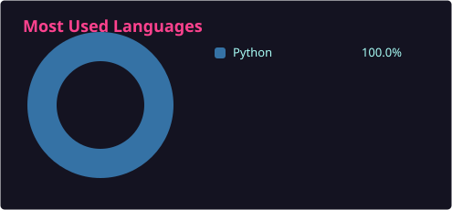

<h1 align="center">Farshad Rahmani</h1>

  <strong>Computational Mechanics · Numerical Methods · Scientific Computing</strong>

  <a href="https://farshadrhni.github.io/">Website</a> ·
  <a href="https://www.linkedin.com/in/farshad-rahmani-58b71214b">LinkedIn</a> ·
  <a href="https://scholar.google.com/citations?user=XN_h7GIAAAAJ&hl=en">Google Scholar</a> ·
  <a href="https://orcid.org/0000-0002-6926-5651">ORCID</a> ·
  <a href="mailto:farshad.civil.rhni@gmail.com">Email</a>

## About

I am a computational mechanics researcher interested in numerical methods for structural and material modelling. I develop solvers for beam, plate, and shell structures using the finite element method (FEM), Galerkin isogeometric analysis (IGA), and isogeometric collocation (IGA-C). My research focuses on nonlinear structural mechanics, constitutive modelling, and coupled thermomechanical problems.

## Research & Development

- **Structural mechanics** — beam, plate, and shell formulations, including geometrically exact models.
- **Numerical methods** — finite element and isogeometric analysis, with an emphasis on collocation methods.
- **Constitutive modelling** — smart materials, shape-memory behaviour, and thermo-viscoelasticity.
- **Solver development** — implementation, verification, and assessment of numerical methods.
- **Applications** — shape-changing structures, 4D printing.

## Contact

Open to research collaborations in computational mechanics, numerical methods, and scientific software development.

[Email](mailto:farshad.civil.rhni@gmail.com) · [LinkedIn](https://www.linkedin.com/in/farshad-rahmani-58b71214b)

## Programming & Tools

  
  
  
  
  
  
  

